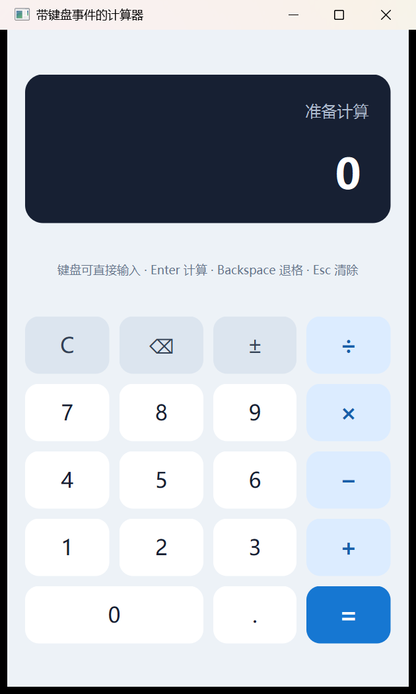
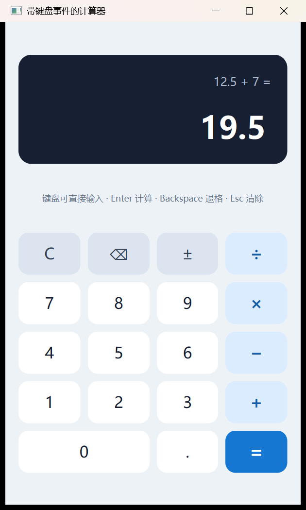
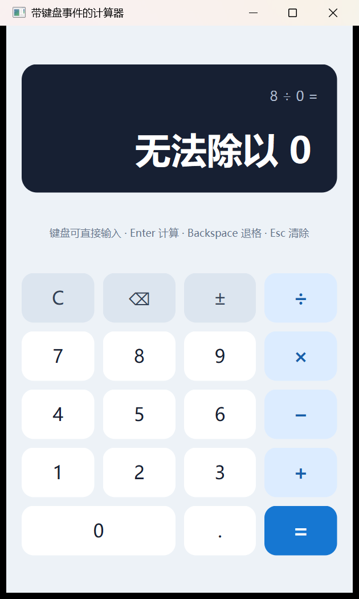

# 实验 1：带键盘事件的计算器

这是一个使用 Qt 6.10.3 和 Qt Widgets 实现的桌面计算器。界面由
Qt Designer 的 `calculator.ui` 完成，计算状态与界面分离，鼠标按钮和键盘
事件统一进入 `CalculatorCore::inputToken()` 处理。



## 功能

- 加、减、乘、除四则运算
- 小数和负数输入
- 退格、清除和正负号切换
- 连续运算与连续按等号
- 运算完成后用数字开始新计算
- 运算完成后用操作符继续计算
- 连续小数点只接受一次
- 连续操作符以后一个操作符为准
- 除零和计算结果溢出提示
- 鼠标与键盘输入复用同一套状态机
- 键盘和鼠标混合输入

## 键盘操作

| 按键 | 功能 |
| --- | --- |
| `0` 到 `9` | 输入数字，支持数字小键盘 |
| `.` | 输入小数点 |
| `+`、`-`、`*`、`/` | 加、减、乘、除 |
| `Enter` 或 `=` | 计算结果 |
| `Backspace` | 退格 |
| `Esc`、`C` 或 `Delete` | 清除 |
| `F9` | 切换正负号 |

## 运行

在 Qt Creator 中打开 `Experiment1_Calculator.pro`，选择
`Desktop Qt 6.10.3 MinGW 64-bit` 套件后运行。

也可以在 PowerShell 中执行：

```powershell
mkdir build
cd build
& "D:\Qt\6.10.3\mingw_64\bin\qmake.exe" ..\Experiment1_Calculator.pro
& "D:\Qt\Tools\mingw1310_64\bin\mingw32-make.exe"
.\release\Experiment1_Calculator.exe
```

## 测试

核心状态机测试：

```powershell
mkdir build-tests
cd build-tests
& "D:\Qt\6.10.3\mingw_64\bin\qmake.exe" ..\tests\calculator_tests.pro
& "D:\Qt\Tools\mingw1310_64\bin\mingw32-make.exe"
.\release\tst_calculatorcore.exe
```

界面交互测试：

```powershell
mkdir build-ui-tests
cd build-ui-tests
& "D:\Qt\6.10.3\mingw_64\bin\qmake.exe" ..\tests\ui_tests.pro
& "D:\Qt\Tools\mingw1310_64\bin\mingw32-make.exe"
.\release\tst_calculatormainwindow.exe
```

测试覆盖连续小数点、连续操作符、连续运算、除零恢复、结果后继续输入、
退格、清除、负数前导零以及鼠标与键盘混合输入。详细测试记录见
[docs/TESTING.md](docs/TESTING.md)。

## 实验交付

- [实验报告](docs/实验1-带键盘事件的计算器实验报告.docx)
- [演示视频（2 分 31 秒）](docs/demo/实验1-带键盘事件的计算器-演示视频.mp4)

演示视频连续展示鼠标小数运算、键盘运算、退格与清除、连续运算、除零恢复、
重复小数点和连续操作符，并展示开发阶段的 Git 提交历史。

## 代码结构

| 文件 | 作用 |
| --- | --- |
| `calculator.ui` | Qt Designer 界面、控件命名和网格布局 |
| `calculatormainwindow.h/.cpp` | 按钮与键盘事件适配、界面更新 |
| `calculatorcore.h/.cpp` | 操作数、操作符、结果与异常状态管理 |
| `styles/calculator.qss` | 按钮、显示区和输入提示的样式 |
| `tests/` | QtTest 核心逻辑与界面交互测试 |

`CalculatorMainWindow` 不直接计算数值。按钮的 `calculatorToken` 动态属性、
键盘映射和测试输入都转换为相同指令，因此两类输入不会产生不同结果。

## 边界行为

连续运算采用普通计算器的即时求值方式。例如输入 `2+3×4=` 时，先得到
`5`，再乘以 `4`，最终结果为 `20`。

当第二个操作数为零时，显示区提示“无法除以 0”。此时输入数字会开始一次
新计算，不需要先手动清除。计算完成后直接输入数字会开始新计算，输入
操作符则会把当前结果作为下一次运算的左操作数。





## 开发记录

本项目在 Qt 6.10.3 MinGW 64 位环境开发和编译。开发中使用 AI 辅助生成
初始方案和代码，并通过编译检查、QtTest 自动化测试、实际键盘输入和界面
截图逐项验证。自动测试曾发现“先输入正负号，再输入数字时显示 `-03`”的
问题，代码已改为直接显示 `-3` 并增加回归测试。
