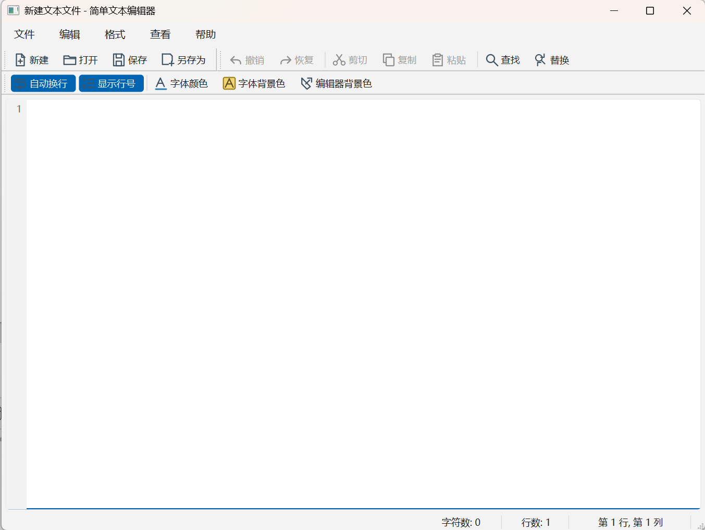

# 实验 2：简单文本编辑器

这是一个使用 Qt Widgets 和 Qt Designer 实现的桌面文本编辑器。主窗口负责文件
生命周期和功能联动，编辑器通过自定义 `CodeEditor` 派生类显示行号。



## 功能

- 新建、打开、保存、另存为和退出
- 修改状态提示与未保存文件确认
- 撤销、重做、剪切、复制、粘贴和全选
- Action 可用状态随选区和编辑历史自动更新
- 查找、连续循环查找和区分大小写
- 单次替换、全部替换及整体撤销
- 字体、字体颜色、文字背景色和编辑器背景色
- 自动换行、行号显示开关
- 状态栏字符数、行数和当前行列
- 工具栏和状态栏显隐
- 自定义关于对话框
- 每 10 秒检查一次的定时自动保存

## 构建环境

- Qt 6.10.3 MinGW 64 位
- Qt Creator 20.0.1
- qmake
- C++17

在 Qt Creator 中打开
`Experiment2_SimpleTextEditor.pro`，选择
`Desktop Qt 6.10.3 MinGW 64-bit` 套件后构建运行。

也可以使用命令行构建：

```powershell
New-Item -ItemType Directory -Force build | Out-Null
Push-Location build
& "D:\Qt\6.10.3\mingw_64\bin\qmake.exe" ..\Experiment2_SimpleTextEditor.pro
& "D:\Qt\Tools\mingw1310_64\bin\mingw32-make.exe"
Pop-Location
```

## 代码结构

| 文件 | 作用 |
| --- | --- |
| `mainwindow.ui` | 主窗口、菜单、Action 和工具栏 |
| `mainwindow.h/.cpp` | 文件操作、编辑状态、格式、查找替换和自动保存 |
| `codeeditor.h/.cpp` | 派生自 `QPlainTextEdit` 的带行号编辑器 |
| `finddialog.ui/.h/.cpp` | 查找对话框 |
| `replacedialog.ui/.h/.cpp` | 替换对话框 |
| `aboutdialog.ui/.h/.cpp` | 关于对话框 |
| `resources.qrc` 与 `icons/` | 菜单和工具栏图标 |

## 测试

主要功能和边界测试记录见 `docs/TESTING.md`，AI 辅助开发过程见
`docs/AI_DEVELOPMENT.md`。
